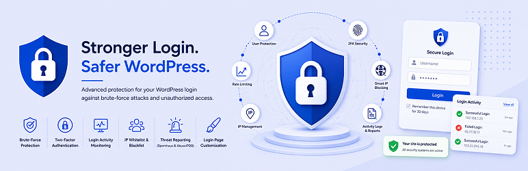

<p align="center">
  
</p>

# WP-Login Guardian

🛡️ **WP-Login Guardian** is an advanced WordPress security plugin that protects your website from brute-force attacks, unauthorized login attempts, username enumeration, and malicious IPs. It combines login protection, two-factor authentication (2FA), activity monitoring, IP management, and threat intelligence into one lightweight security solution.

---

## ✨ Features

* 🔒 Smart login rate limiting and brute-force protection
* 🚫 Username enumeration protection
* 🔐 Two-Factor Authentication (TOTP)
* 📊 Login activity monitoring with CSV export
* 🌐 IP whitelist and blacklist management
* 🚨 Automatic and manual reporting to Spamhaus and AbuseIPDB
* 🎨 Login page customization
* ⚡ Lightweight and performance optimized

---

## 🚀 Deployment

1. Clone or download this repository.
2. Upload the `wp-login-guardian` directory to:

```text
wp-content/plugins/
```

3. Activate the plugin from **Plugins** in your WordPress dashboard.
4. Configure **WP-Login Guardian** from the WordPress Admin menu.

---

## 🐛 Issues & Feature Requests

Please use the GitHub repository to report bugs, request features, or contribute:

**Repository:** https://github.com/opcodesdotin/wp-login-guardian

---

## 📄 License

Licensed under the GPL v2 or later.

---

## 👥 Maintainers

* **@ygohel18**

Repository: **https://github.com/opcodesdotin/wp-login-guardian**